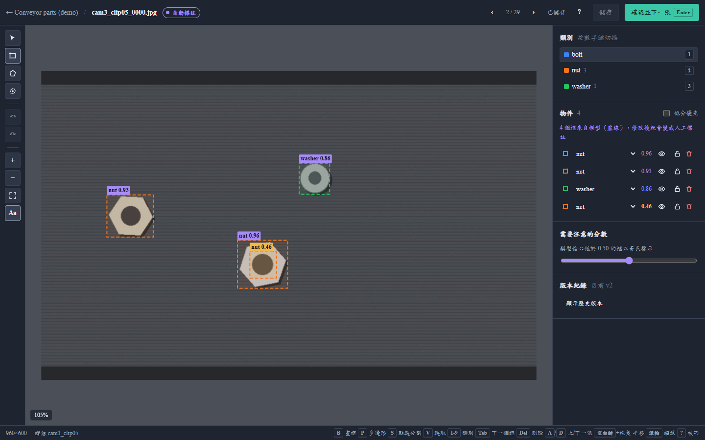
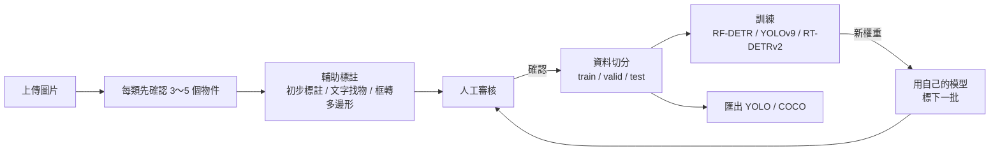
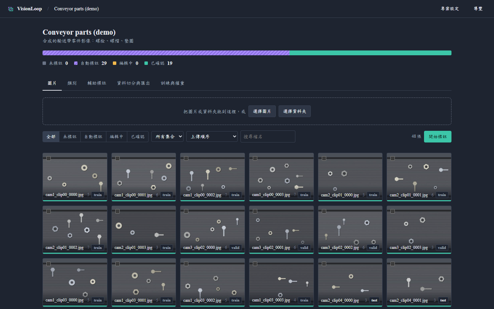
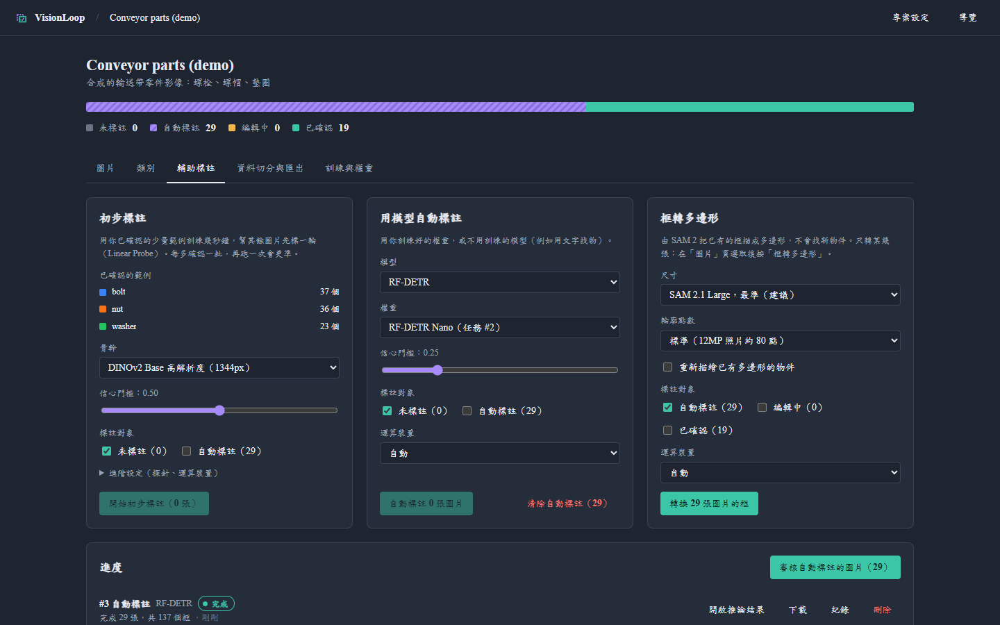
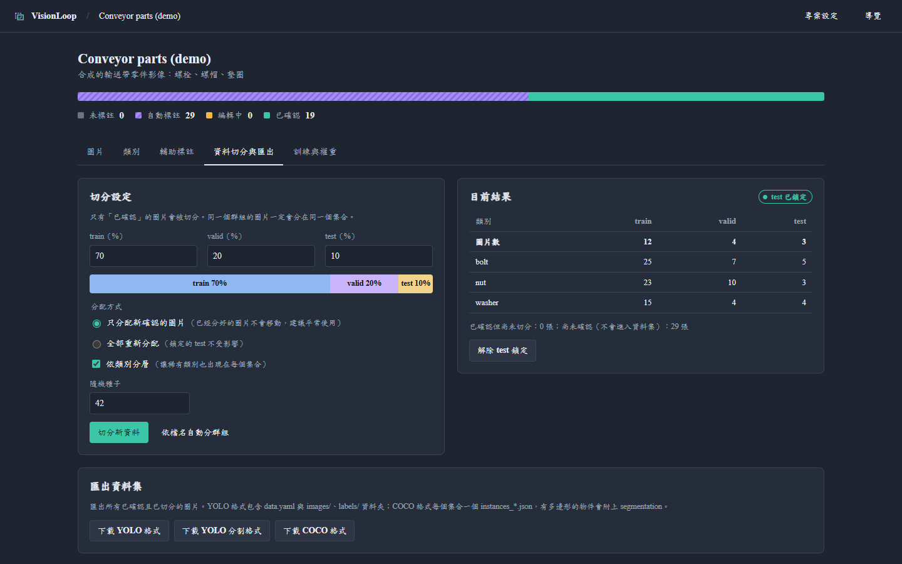
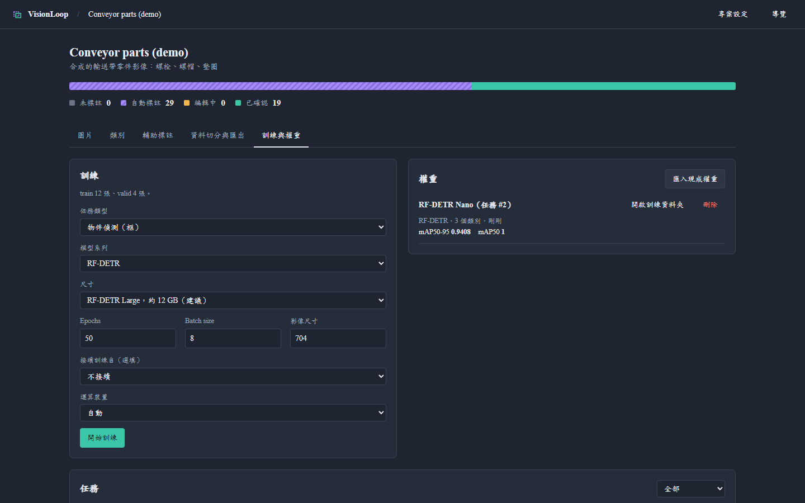

# VisionLoop

在本機執行的物件偵測與實例分割資料平台：標註、模型輔助標註、審核、資料切分、訓練，串成一個循環。核心以 MIT 授權開源，可商用。



先標幾個物件，讓模型標出其餘圖片，人只負責審核修正；確認過的資料切分後訓練自己的模型，再用它標下一批。每轉一圈，模型越準，要改的越少。



## 安裝（Windows）

不需要事先安裝 Python。使用模型需要 NVIDIA 顯示卡驅動。

1. 到 [Releases](../../releases/latest) 的 **Assets** 下載 `visionloop-*.zip`（不是「Source code」），解壓到路徑沒有中文或空白的資料夾，例如 `D:\visionloop`。
2. 在該資料夾的檔案總管網址列輸入 `powershell`，執行：

   ```powershell
   powershell -ExecutionPolicy Bypass -File scripts\setup_windows.ps1
   ```

   約 10～20 分鐘，會下載預設模型權重（約 2～3 GB），並詢問是否安裝 YOLOv9（GPL-3.0）。只需要標註時加上 `-SkipModels`。
3. 雙擊桌面上的 **VisionLoop**。第一次開啟會有導覽。

**更新**：有新版本時畫面上方會出現提示，按「立即更新」在背景下載並核對，再按「重新啟動並更新」。更新前會備份，新版本無法啟動就自動還原；`data\`（專案、圖片、權重）、`models\`、`local_settings.json` 和自訂外掛都不會被動到。用 git 下載的請用 `git pull`。v0.1.3 以前的版本需要手動下載一次新的 zip 覆蓋程式檔。

## 功能

**標註與審核**

- 框、多邊形（`P`）、點選分割（`S`，SAM 2.1：左鍵點物件、右鍵排除，已標註的區域自動扣除）
- 模型產生的框以虛線顯示並附信心分數，低分的框以黃色標示；可依最低分數排序，先審最可能錯的圖片
- 數字鍵切換類別、`Tab` 逐一檢查、方向鍵微調、復原 / 重做；每次儲存都留下版本，可以還原
- 狀態：未標註 → 自動標註 → 編輯中 → 已確認，只有已確認的圖片進入資料集
- 選取的圖片在開圖、換頁、換篩選時都會保留，可批次設定群組、框轉多邊形或刪除

**輔助標註**

- **初步標註（DINOv2 Linear Probe）**：每類確認 3～5 個物件就能開始，幾秒鐘訓練完並標出其餘圖片；每多確認一批，再跑一次更準
- **用模型自動標註**：用自己訓練的權重、匯入的 COCO 預訓練權重，或 Grounding DINO 的文字描述
- **框轉多邊形**：SAM 2 依照既有的框描出輪廓
- 每次用模型標註都保留推論結果：畫好框的圖片，以及不含信心分數的 YOLO 標籤檔，可開啟資料夾或下載 zip
- 自動標註不會覆蓋已確認或正在編輯的圖片

**資料切分與匯出**

- 依類別分層，稀有類別也會出現在每個集合
- 同一群組的圖片（例如同一段影片、同一個物件的連拍）一定分在同一個集合，避免 test 分數虛高；可依檔名自動分群組
- 增量切分：只分配新確認的圖片；test 可鎖定，不同時期的模型用同一批 test 比較
- 匯出 YOLO、YOLO 分割、COCO（含 `segmentation`）

**訓練**

- RF-DETR、RF-DETR Seg、YOLOv9 / GELAN、YOLOv9 分割、RT-DETRv2，皆為原作者實作，以獨立程序執行
- 依顯存建議模型尺寸，可接續既有權重訓練
- 訓練曲線、混淆矩陣、PR 曲線等圖表保留在訓練資料夾，可從權重列表直接開啟
- 背景任務佇列，即時進度與紀錄，可取消

## 畫面

| 圖片 | 輔助標註 |
| --- | --- |
|  |  |

| 資料切分與匯出 | 訓練與權重 |
| --- | --- |
|  |  |

## 硬體需求

| 用途 | 需要 |
| --- | --- |
| 標註、審核、切分、匯出 | 任何電腦 |
| 初步標註、點選分割、框轉多邊形 | NVIDIA 顯示卡，約 2 GB 以上顯存 |
| 訓練 | 建議 8 GB 以上顯存 |
| 磁碟 | 約 10 GB，另加圖片 |

## 模型

| 模型 | 用途 | 需要 | 授權 |
| --- | --- | --- | --- |
| DINOv2 Probe | 初步標註 | 每類 3～5 個已確認物件 | Apache-2.0 |
| Grounding DINO | 用英文描述找物件 | 每類一句描述 | Apache-2.0 |
| SAM 2.1 | 點選分割、框轉多邊形 | 不需要訓練 | Apache-2.0 |
| RF-DETR N/S/M/L | 物件偵測 | 切分好的資料 | Apache-2.0 |
| RF-DETR Seg N/S/M/L | 實例分割 | 已確認的多邊形 | Apache-2.0 |
| YOLOv9 T/S/M/C/E、GELAN S/M/C/E | 物件偵測 | 切分好的資料 | GPL-3.0（外部執行） |
| YOLOv9 分割（GELAN-C-SEG） | 實例分割 | 已確認的多邊形 | GPL-3.0（外部執行） |
| RT-DETRv2 | 物件偵測 | 切分好的資料 | Apache-2.0 |

建議流程：每類框幾個 → 初步標註 → 審核修正 → 累積 30～50 張後訓練 RF-DETR → 用它標剩下的圖片 → 每多確認一批就重新訓練。

YOLOv9 會用原作者的預訓練權重微調，第一次使用某個尺寸時自動下載（YOLOv9-T 沒有預訓練權重）。RF-DETR 的 XL / 2XL 使用 PML 授權，因此不提供。

## 其他安裝方式

**macOS / Linux**（Python 3.10+、Node.js 18+）

```bash
git clone https://github.com/chuan92329/visionloop.git
cd visionloop
python -m venv .venv && source .venv/bin/activate
pip install -r backend/requirements.txt
./scripts/start.sh            # http://127.0.0.1:8000
python scripts/demo_data.py   # 另開終端機：載入 48 張合成的示範圖片
```

**Docker**：`docker compose up --build`，資料存在 `./data`。

**開發模式**：`pip install -r backend/requirements-dev.txt`、`cd frontend && npm install`，再執行 `./scripts/dev.sh`（API :8000 + Vite :5173）。API 文件在 `/docs`。

**Windows 安裝參數**：`-Yolov9 yes|no`、`-SkipWeights`、`-SkipModels`、`-Cuda cu126`（較舊的顯示卡）、`-PythonManager uv|conda`、`-NoShortcut`。安裝程式會用現有的 conda，沒有的話用 [uv](https://github.com/astral-sh/uv) 把 Python 裝在專案資料夾內，不影響電腦上其他的 Python。平台與模型分成 `visionloop`、`vl-models` 兩個環境。

### 手動設定 YOLOv9 / RT-DETRv2

clone 原作者的 repository，再用環境變數或 `local_settings.json` 指定位置：

```bash
git clone https://github.com/WongKinYiu/yolov9
export VISIONLOOP_YOLOV9_REPO=$PWD/yolov9
export VISIONLOOP_YOLOV9_PYTHON=/path/to/yolov9-env/bin/python

git clone https://github.com/lyuwenyu/RT-DETR
export VISIONLOOP_RTDETR_REPO=$PWD/RT-DETR/rtdetrv2_pytorch
export VISIONLOOP_RTDETR_PYTHON=/path/to/rtdetr-env/bin/python
```

RT-DETRv2 的 COCO 預訓練權重放在 `rtdetrv2_pytorch/weights/`。重新啟動後，「訓練與權重」頁會顯示外掛為「可用」。

### 加入其他模型

在 `backend/plugins/` 放一個實作 `train()` 和 `predict()` 的 Python 檔，見 [backend/plugins/README.md](backend/plugins/README.md)。

## 設計重點

- **授權**：Ultralytics 的 YOLO 採 AGPL-3.0。VisionLoop 只以獨立程序執行原作者的程式，平台本身不 import 任何模型框架，核心維持 MIT。詳見 [THIRD_PARTY_NOTICES.md](THIRD_PARTY_NOTICES.md)。
- **切分演算法**（`backend/app/services/split.py`）：以群組為單位的 iterative stratification，含最稀有類別的群組先分配，每個群組放到最接近目標比例的集合。
- **DINOv2 Probe**：以物件輪廓內的比例作為每個 patch 的軟標籤訓練，再從物件機率圖找出連通區域轉成框；已確認圖片的特徵會快取，只需計算新圖片。
- **資料與框架無關**：資料庫存像素座標，匯出或訓練時才轉成 YOLO 或 COCO 格式。所有修改都經過同一個函式，負責邊界裁切、狀態流轉與版本紀錄。

## 測試

```bash
cd backend && pytest
cd frontend && npm test
```

模型外掛以模擬原專案命令列的假腳本測試，沒有 GPU 的 CI 也能執行；實際推論用 `scripts/check_models_env.py` 在有 GPU 的電腦上驗證。

## 授權

[MIT](LICENSE)。模型程式碼與權重的授權另計，見 [THIRD_PARTY_NOTICES.md](THIRD_PARTY_NOTICES.md)。
