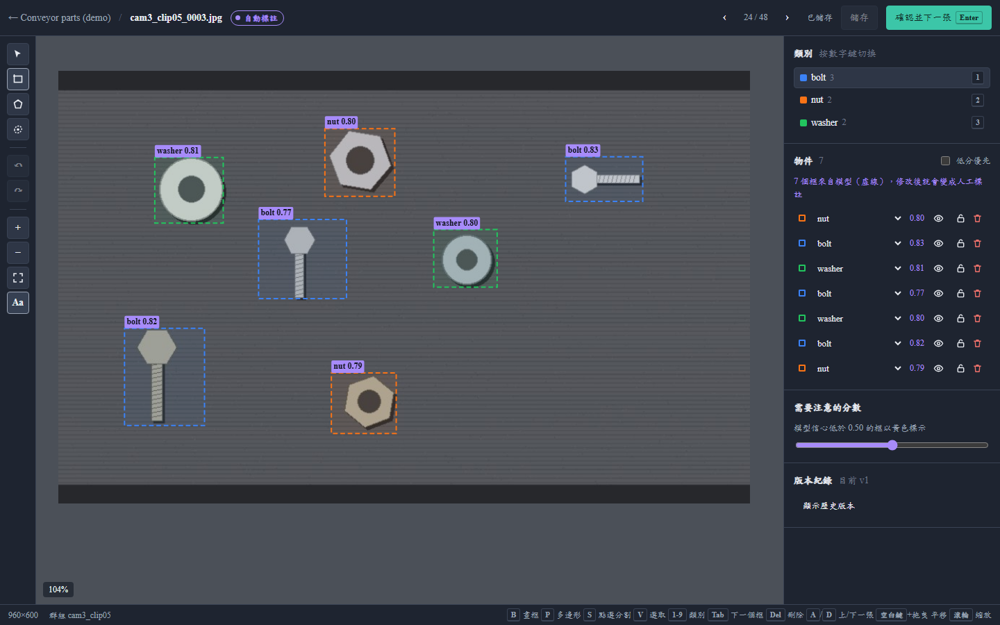
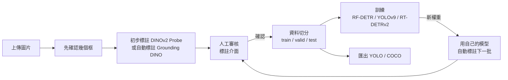
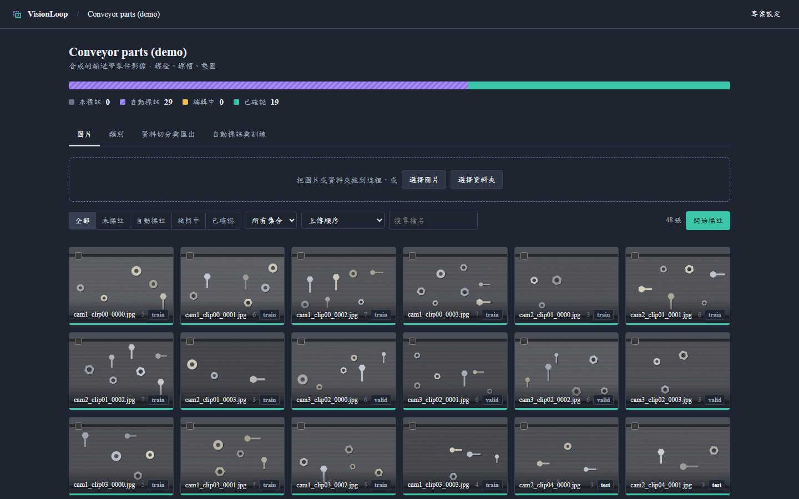
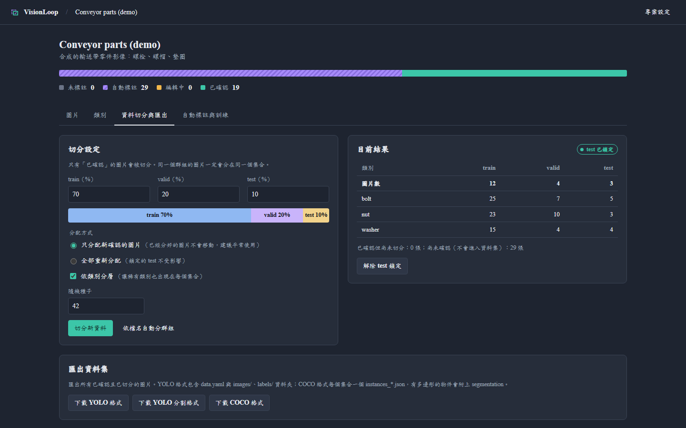
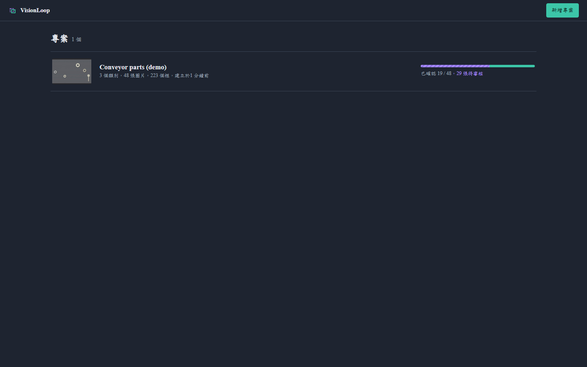
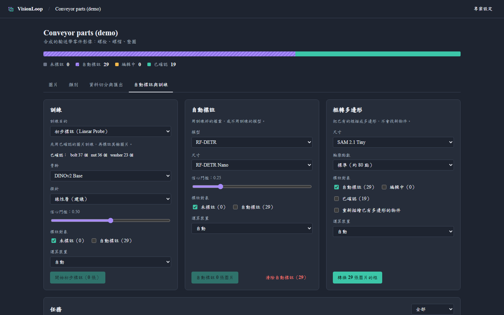

# VisionLoop

自動標註、人工審核、資料切分、模型訓練串成一個閉環的物件偵測資料平台。可在本機執行，核心以 MIT 授權開源，可商用。



模型先幫新圖片打框，人只需要檢查和修正。確認過的資料自動分成 train / valid / test，訓練出新模型，再用新模型標註下一批圖片。每轉一圈，模型越準，人工修正越少。



## 三分鐘上手（Windows）

不需要事先安裝 Python 或其他軟體。要使用初步標註、點選分割或訓練，需要 NVIDIA 顯示卡驅動。

1. **下載**：到 [Releases](../../releases) 下載最新的 `visionloop-*.zip`。
2. **解壓縮**：例如解壓到 `D:\visionloop`。建議路徑不要有中文或空白。
3. **開啟 PowerShell**：在該資料夾的檔案總管網址列輸入 `powershell`，按 Enter。
4. **安裝**（約 10～20 分鐘，視網速而定）：

   ```powershell
   powershell -ExecutionPolicy Bypass -File scripts\setup_windows.ps1
   ```

   過程中會下載預設的模型權重（約 2～3 GB），並詢問是否下載 YOLOv9 / GELAN（GPL-3.0 授權）。沒有 NVIDIA 顯示卡、只需要標註時，加上 `-SkipModels`。
5. **開始使用**：雙擊桌面上的 **VisionLoop**。第一次開啟會出現導覽，帶你走一遍完整流程。

之後只要雙擊捷徑即可。更新版本時，用新的 zip 覆蓋程式檔即可，專案與圖片都在 `data/` 資料夾，請勿刪除。詳細說明與其他系統見[快速開始](#快速開始)。

## 功能

**標註與審核**

- 拉框、移動、縮放，框永遠不會超出圖片
- 滑鼠滾輪縮放、空白鍵加拖曳平移、十字輔助線
- 數字鍵 1–9 切換類別，`Tab` 逐一檢查每個框，方向鍵微調位置
- 復原 / 重做；每次儲存都留下版本，可以還原到任何一版
- 模型產生的框以虛線顯示並附信心分數；低於門檻的框以黃色標示，需要優先檢查
- 依「最低信心分數」排序工作佇列，從最可能出錯的圖片開始審
- 狀態流轉：未標註 → 自動標註 → 編輯中 → 已確認。只有已確認的圖片會進入資料集
- 樂觀鎖定：同一張圖在兩個分頁被修改時，後存的一方會收到提醒而不是覆蓋

**資料切分**

- 依類別分層，稀有類別也會出現在每個集合
- 群組不拆開：同一段影片、同一台相機的連續影格一定在同一個集合，避免資料洩漏讓 test 分數虛高；可依檔名規則自動分群組
- 預設增量切分：新確認的圖片才分配，已經分好的不會移動
- test 集合可鎖定，不同時間訓練的模型都用同一批 test 圖片比較
- 匯出 YOLO（`data.yaml` + `images/` + `labels/`）或 COCO（`instances_*.json`）

**自動標註與訓練**

- **初步標註**（訓練區的「訓練目的」）：每個類別先確認 3～5 個框就能開始，不用先切分資料，用來減少初期的人工標註：
  - **DINOv2 Probe**：凍結 DINOv2，用所有已確認的圖片訓練一層線性探針或小型 MLP（幾秒鐘），再把熱力圖轉成框；有多邊形的物件會用輪廓訓練。每次執行都用最新的確認結果重新訓練
- **零樣本**：**Grounding DINO** 用英文描述（例如「a hex nut」）直接找物件
- **可訓練的偵測器**：**RF-DETR**（N/S/M/L）、**YOLOv9**、**RT-DETRv2**，都是原作者實作，以獨立程序執行
- 依顯示卡記憶體建議模型尺寸
- 一鍵清除模型產生的框（只影響尚未被人動過的圖片）
- 背景任務佇列，即時進度與紀錄，可取消
- 自動標註**絕不覆蓋**已確認或正在編輯的圖片
- **點選分割**：按 `S` 後左鍵點物件、右鍵排除、拖曳框選，SAM 2.1 Large 即時描出輪廓，按 Enter 變成多邊形。預設會「扣除已標註」：已經描好的輪廓會從結果中扣掉，被蓋住的物件只留下看得到的部分。模型在背景常駐，第一次約需數秒載入，之後每次點擊不到 1 秒；閒置 10 分鐘自動關閉並釋放顯存
- 任務紀錄可篩選、刪除與一鍵清除失敗或已取消的任務；刪除紀錄不會刪掉訓練好的權重
- **多邊形分割**：按 `P` 逐點畫多邊形，或用 SAM 2 把既有的框轉成多邊形（已確認的圖片轉換後要重新確認）。多邊形同時保留外接框，偵測訓練不受影響；可匯出 YOLO 分割格式與含 `segmentation` 的 COCO，或訓練 RF-DETR Seg、YOLOv9 分割。每個物件只有一個外框，不支援挖洞
- 可匯入官方 COCO 預訓練權重，類別用名稱自動對應到專案類別，直接做第一輪自動標註

## 畫面

| 圖片庫與工作佇列 | 資料切分 |
| --- | --- |
|  |  |

| 專案列表 | 自動標註與訓練 |
| --- | --- |
|  |  |

## 硬體需求

| 用途 | 需要 |
| --- | --- |
| 只用標註、審核、切分與匯出 | 任何電腦，不需要顯示卡 |
| 初步標註（DINOv2 Probe）、點選分割（SAM 2.1 Large） | NVIDIA 顯示卡，約 2 GB 以上顯存 |
| 訓練 RF-DETR / YOLOv9 / RT-DETRv2 | 建議 8 GB 以上顯存；介面會依顯存建議模型尺寸 |
| 磁碟空間 | 約 10 GB（兩個環境約 5 GB，加上第一次使用時下載的模型權重），另外加上你的圖片 |

## 快速開始

### Windows（建議，含 GPU 模型環境）

不需要事先安裝 Python；要使用模型則需要 NVIDIA 顯示卡驅動。用 `git clone` 下載，或到 [Releases](../../releases) 下載 `visionloop-*.zip`（已內含建置好的前端），解壓縮後在專案資料夾執行：

```powershell
powershell -ExecutionPolicy Bypass -File scripts\setup_windows.ps1   # 第一次，約 10～20 分鐘
```

完成後，桌面與開始功能表會出現「**VisionLoop**」，雙擊就會以獨立視窗開啟（先播放一段手寫的 VisionLoop 開場，同時在背景啟動），不需要瀏覽器；關閉視窗即結束程式，包含背景的模型程序。

視窗開著的時候，也可以用瀏覽器打開 <http://127.0.0.1:8000> 操作同一份資料。不想建立捷徑可以加上 `-NoShortcut`，之後用 `scripts\desktop.ps1` 開啟。

`setup_windows.ps1` 會自動準備 Python：電腦上已經有 conda（Miniconda / Anaconda）就用 conda；沒有的話，會下載 [uv](https://github.com/astral-sh/uv)（約 20 MB 的 Python 安裝工具），由它把 Python 裝在專案資料夾的 `tools\`，環境放在 `envs\`，不會影響電腦上其他的 Python。用 `git clone` 下載、又沒有 Node.js 時，也會把 Node.js 下載到 `tools\` 來建置介面。

接著建立兩個環境，並把路徑寫進 `local_settings.json`，之後不需要再設定任何環境變數：

| 環境 | 內容 |
| --- | --- |
| `visionloop` | 平台本身（FastAPI、Pillow…），不含 PyTorch |
| `vl-models` | PyTorch（CUDA 13.0）、RF-DETR、transformers（Grounding DINO、SAM 2），以及 clone 到 `models/yolov9` 的 YOLOv9 |

它也會先下載各模型的預設權重（皆為 Apache-2.0，約 2～3 GB），打開後第一次使用就不用等：

| 權重 | 用途 |
| --- | --- |
| DINOv2 Base | 初步標註（預設 1344px 高解析度） |
| SAM 2.1 Large | 點選分割、框轉多邊形 |
| Grounding DINO Base | 用文字描述找物件 |
| RF-DETR（依顯存選擇：12 GB 以上 Large、8 GB Medium、6 GB Small，其餘 Nano） | 訓練的起點，存在 `models/rfdetr`，所有訓練共用 |

其他尺寸在第一次使用時才下載，介面會顯示「第一次使用，正在下載…（約 N MB）」。**YOLOv9 / GELAN 使用 GPL-3.0 授權，安裝時會先詢問要不要下載**；不安裝也不影響其他模型，之後可以用 `-Yolov9 yes` 補裝。

最後它會執行 `scripts/check_models_env.py`，確認 PyTorch 看得到 GPU。常用參數：

| 參數 | 作用 |
| --- | --- |
| `-Yolov9 yes` / `-Yolov9 no` | 事先回答是否安裝 YOLOv9 / GELAN（自動化安裝時使用） |
| `-SkipWeights` | 先不下載預設權重，第一次使用時才下載 |
| `-SkipModels` | 只安裝平台本身，不安裝 PyTorch 與模型 |
| `-Cuda cu126` | 較舊的顯示卡或驅動 |
| `-PythonManager uv` / `conda` | 指定用 uv 或 conda 準備 Python（預設自動選擇） |
| `-NoShortcut` | 不建立桌面與開始功能表捷徑 |

### macOS / Linux

需要 Python 3.10+ 與 Node.js 18+。

```bash
git clone https://github.com/chuan92329/visionloop.git
cd visionloop

python -m venv .venv
source .venv/bin/activate
pip install -r backend/requirements.txt
./scripts/start.sh
```

打開 <http://127.0.0.1:8000>。

想先看看實際操作的樣子，可以在伺服器啟動後，另開一個終端機載入示範資料：

```bash
python scripts/demo_data.py
```

它會產生 48 張合成的輸送帶零件影像（螺栓、螺帽、墊圈），以標準答案確認其中 40% 並切分，接著就可以用任一模型訓練或自動標註剩下的圖片。

### 開發模式

```bash
pip install -r backend/requirements-dev.txt
cd frontend && npm install && cd ..
./scripts/dev.sh              # API :8000（自動重載）+ Vite :5173
```

API 文件在 <http://127.0.0.1:8000/docs>（FastAPI 自動產生）。

### Docker

```bash
docker compose up --build
```

資料會存在 `./data`。

## 模型

| 模型 | 用途 | 需要什麼 | 授權 |
| --- | --- | --- | --- |
| DINOv2 Probe | 第一輪自動標註、隨確認結果即時更新 | 每類 3～5 個已確認的框 | Apache-2.0 |
| Grounding DINO（文字找物） | 第一輪自動標註 | 每類一句英文描述 | Apache-2.0 |
| RF-DETR N/S/M/L | 訓練自己的偵測器 | 切分好的資料；沒訓練前可用 COCO 預訓練模型 | Apache-2.0 |
| RF-DETR Seg N/S/M/L | 訓練實例分割模型，自動標註時產生多邊形 | 已確認的多邊形標註 | Apache-2.0 |
| YOLOv9 分割（GELAN-C-SEG） | 訓練實例分割模型 | 已確認的多邊形標註 | GPL-3.0（外部執行） |
| SAM 2.1 | 標註頁的點選分割；把既有的框轉成多邊形 | 不需要訓練 | Apache-2.0 |
| YOLOv9 T/S/M/C/E、GELAN S/M/C/E（原作者） | 訓練自己的偵測器；GELAN 沒有輔助分支，訓練較快 | 切分好的資料 | GPL-3.0（外部執行） |
| RT-DETRv2（原作者） | 訓練自己的偵測器 | 切分好的資料 | Apache-2.0 |

建議的流程：先框幾個 → DINOv2 Probe 自動標註 → 審核修正 → 累積 30～50 張後訓練 RF-DETR → 用 RF-DETR 標註剩下的圖片 → 每多確認一批就重新訓練。

RF-DETR、Grounding DINO、SAM 2 在 `vl-models` 環境中執行（`VISIONLOOP_MODELS_PYTHON`）。RF-DETR 的 XL / 2XL 等尺寸使用 PML 授權、需要 Roboflow 帳號，因此不提供。

### 手動設定 YOLOv9 / RT-DETRv2

`setup_windows.ps1` 會詢問是否安裝 YOLOv9（`-Yolov9 yes` 可直接安裝）。手動設定時，請自行 clone 原作者的 repository，再用環境變數（或 `local_settings.json`）告訴 VisionLoop 它們的位置。

**YOLOv9**（[WongKinYiu/yolov9](https://github.com/WongKinYiu/yolov9)，GPL-3.0）

```bash
git clone https://github.com/WongKinYiu/yolov9
python -m venv yolov9-env && yolov9-env/bin/pip install -r yolov9/requirements.txt

export VISIONLOOP_YOLOV9_REPO=$PWD/yolov9
export VISIONLOOP_YOLOV9_PYTHON=$PWD/yolov9-env/bin/python
```

要從預訓練權重微調，把 `yolov9-s.pt`、`yolov9-c.pt`、`gelan-c.pt` 等檔案放在 `yolov9/weights/`，訓練時會自動使用對應尺寸的權重。

**RT-DETRv2**（[lyuwenyu/RT-DETR](https://github.com/lyuwenyu/RT-DETR)，Apache-2.0）

```bash
git clone https://github.com/lyuwenyu/RT-DETR
python -m venv rtdetr-env && rtdetr-env/bin/pip install -r RT-DETR/rtdetrv2_pytorch/requirements.txt

export VISIONLOOP_RTDETR_REPO=$PWD/RT-DETR/rtdetrv2_pytorch
export VISIONLOOP_RTDETR_PYTHON=$PWD/rtdetr-env/bin/python
```

COCO 預訓練權重（例如 `rtdetrv2_r18vd_120e_coco_rerun_48.1.pth`）放在 `rtdetrv2_pytorch/weights/`，會自動用來微調。

重新啟動伺服器後，「自動標註與訓練」頁會顯示外掛狀態為「可用」。

### 加入其他模型

在 `backend/plugins/` 放一個實作 `train()` 和 `predict()` 的 Python 檔即可，見 [backend/plugins/README.md](backend/plugins/README.md)。

## 設計重點

**為什麼只用原作者實作？** Ultralytics 的 YOLO 實作採 AGPL-3.0，閉源商用需要另購授權。VisionLoop 的核心是 MIT，模型以外掛方式接入，並以獨立程序執行原作者 repository 的腳本，平台程式碼本身不 import 任何模型框架。詳見 [THIRD_PARTY_NOTICES.md](THIRD_PARTY_NOTICES.md)。

**切分演算法**（`backend/app/services/split.py`）是以群組為單位的 iterative stratification：含最稀有類別的群組先分配，每個群組放到能讓「圖片數與各類別框數」偏離目標最少的集合（卡方式成本，避免小集合被忽略）。演算法是純函式，有獨立的單元測試，包含群組不拆開、稀有類別覆蓋、相同種子結果一致、鎖定 test 不變等情境。

**DINOv2 Probe**（`plugins/builtin/probe_helper.py`）：每個 patch 的訓練目標是它被各類別覆蓋的比例（軟標籤），有多邊形的物件只算輪廓內，框內的背景不會被當成物件，只有框的物件則算整個框，所以機率 0.5 的等高線會落在物件的邊緣；輸出仍然是框，要輪廓可再用 SAM 2 轉換；推論時先在「物件機率」圖上找連通區域，再用區域內的類別機率決定類別，避免一個物件被拆成好幾類的碎片。已確認圖片的特徵會快取在 `data/feature_cache`，之後只需要計算新圖片。資料夠多時（6 張以上），每次執行會先保留 20% 已確認圖片做自我檢查，在任務紀錄印出召回率與精確度，方便比較不同骨幹。

**標註資料與框架無關**：資料庫存的是像素座標，只有在匯出或訓練時才轉換成 YOLO（歸一化中心點）或 COCO（左上角 + 寬高）格式。

**每一次修改都有紀錄**：所有改動都經過同一個函式（`services/annotations.py`），負責裁切超出邊界的框、狀態流轉與版本快照。

## 專案結構

```
backend/
  app/
    main.py              FastAPI 入口，也負責提供建置好的前端
    models.py            資料表：專案、類別、圖片、標註、版本、任務、權重
    routers/             REST API
    services/
      annotations.py     儲存標註、狀態流轉、版本紀錄
      split.py           分層 + 群組切分演算法（純函式）
      dataset.py         切分統計、YOLO / COCO 匯出
      jobs.py            背景任務：自動標註、訓練
    plugins/
      base.py            模型外掛介面
      builtin/           modern（RF-DETR、Grounding DINO、SAM 2）、yolov9_official、rtdetr_official
                         以及在模型環境中執行的 *_helper.py
  plugins/               放自訂外掛的資料夾
  tests/                 pytest（API、切分演算法、外掛串接）
frontend/
  src/
    pages/               專案列表、專案頁（圖片 / 類別 / 切分 / 模型）、標註頁
    annotator/           Konva 畫布、幾何運算、復原堆疊
scripts/                 環境安裝（setup_windows.ps1）、環境檢查、啟動腳本、獨立視窗（desktop.py）、示範資料產生器
```

## 測試

```bash
cd backend && pytest          # API、切分演算法、外掛串接、點選分割
cd frontend && npm test       # 幾何運算與復原堆疊
```

模型外掛的測試使用模擬原專案命令列、輸出檔與模型環境的假腳本，在沒有 PyTorch 的 CI 環境也能驗證指令組成、範例收集、類別對應、進度解析與座標轉換。真正的模型推論需要在有 GPU 的電腦上用 `scripts/check_models_env.py` 與實際任務驗證。

## 接下來

- 從影片自動抽影格
- 匯入既有的 YOLO / COCO 標註
- 訓練曲線圖表、模型之間的 test 指標比較
- 主動學習：優先挑模型最不確定的圖片給人審核

## 授權

[MIT](LICENSE)。模型程式碼與權重的授權另計，見 [THIRD_PARTY_NOTICES.md](THIRD_PARTY_NOTICES.md)。
